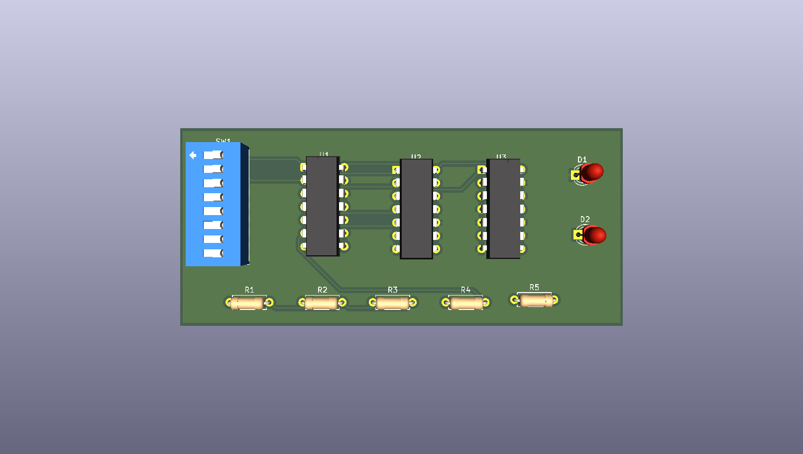

# Full Adder PCB

A 1-bit full-adder schematic and routed PCB I designed in KiCad during a PCB-design workshop. The design uses discrete 74LS-series logic ICs, switch inputs, and two LED outputs to explore binary addition in hardware.

**Status:** Schematic, PCB layout, and manufacturing exports are included. The image above is a KiCad render, not a photograph of an assembled board. Physical fabrication and testing are not documented in this repository; exported Gerbers do not by themselves establish manufacturing readiness.

## How a full adder works

A full adder adds three one-bit inputs: A, B, and carry-in (Cin). It produces a sum bit and carry-out (Cout).

- Sum = A XOR B XOR Cin
- Cout = (A AND B) OR (Cin AND (A XOR B))

| A | B | Cin | Sum | Cout |
|---|---|-----|-----|------|
| 0 | 0 | 0 | 0 | 0 |
| 0 | 0 | 1 | 1 | 0 |
| 0 | 1 | 0 | 1 | 0 |
| 0 | 1 | 1 | 0 | 1 |
| 1 | 0 | 0 | 1 | 0 |
| 1 | 0 | 1 | 0 | 1 |
| 1 | 1 | 0 | 0 | 1 |
| 1 | 1 | 1 | 1 | 1 |

This is the expected logic behavior, not a record of measured hardware results.

## Design files

| Folder | Contents |
|---|---|
| [hardware](hardware/) | Editable KiCad project, schematic, and routed PCB |
| [docs](docs/) | Schematic PDF exports and 3D board preview |
| [manufacturing](manufacturing/) | Front/back copper, solder mask, silkscreen, board outline, plated/non-plated drill files, and Gerber job file |

Open [the schematic PDF](docs/schematic.pdf) for a quick look without KiCad. A second supplied schematic export is preserved as `schematic-alternate-export.pdf`.

## Components in the schematic

| Reference | Component | Quantity |
|---|---|---:|
| U1 | 74LS86 XOR logic IC | 1 |
| U2 | 74LS08 AND logic IC | 1 |
| U3 | 74LS32 OR logic IC | 1 |
| SW1 | 8-position DIP switch | 1 |
| R1–R3 | 10 kΩ resistors | 3 |
| R4–R5 | 330 Ω resistors | 2 |
| D1–D2 | LEDs | 2 |

The schematic uses +5 V and GND power nets. The supplied Gerber job describes a two-layer, 1.6 mm board with an approximately 85.05 × 38.05 mm outline. These are exported design settings, not measured board dimensions.

## Open and inspect

1. Download or clone this repository.
2. Open `hardware/Full_Adder_PCB.kicad_pro` in KiCad. The supplied exports identify KiCad 10.0.6.
3. Use Schematic Editor to inspect the logic and PCB Editor to inspect placement and routing.
4. Open the Gerbers and drill files together in Gerber Viewer to inspect the exported layers.

Before ordering a board, run ERC and DRC, review any unconnected nets, and confirm power connections, IC supply decoupling, unused gate inputs, switch input levels, and LED drive against the component datasheets. No passing ERC/DRC report is included here.

## Repository housekeeping

The source files and manufacturing exports retain the original design contents. Upload-added filename suffixes were removed so the KiCad project files share a base name and the Gerber job references resolve correctly. Temporary KiCad lock files and machine-local `.kicad_prl` settings are excluded.

Designed by **Adhyayan Tiwari**.
